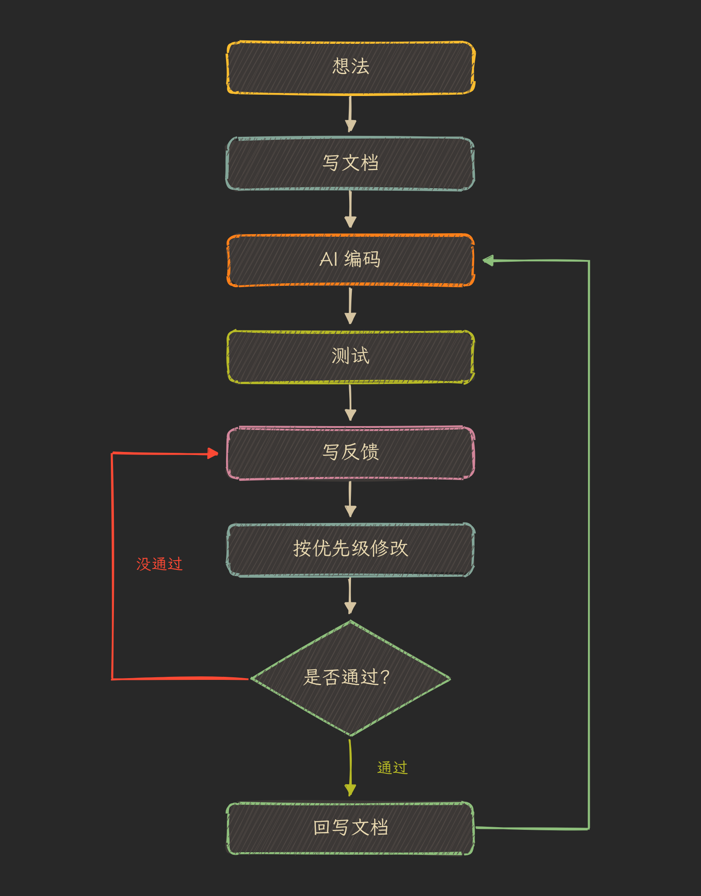

最近一个人做产品，写代码、写文档、做评审都交给 AI，自己只管拿主意和测试。试了一段时间，流程固定了下来，记在这里，照着用应该就能上手。



## 一、核心原则

每一步都落成文件，不靠聊天记录记事。

聊天记录会越来越长，换个工具或者过几周就找不回来了。讨论出的结论、要改的问题、定下的规则，都写进文件，放进 Git 仓库。

需求文档是唯一可信的版本。代码和需求对不上时，以文档为准；需求要变，先改文档。

## 二、分工

人负责决策、测试和验收。做不做、先做哪个、改得对不对，这些由自己定。

AI 助手负责讨论、写文档和做评审。我用的是 Grok Bot，和它聊想法，让它把结论整理成文档，测试时发截图给它，让它写成反馈。

AI 编码工具负责写代码。我用的是 Claude，把文档交给它，它照着写。

## 三、五个步骤

### 1. 想清楚

动手前先和 AI 助手聊几个问题：做得出来吗，给谁用，要花多少钱和时间，需不需要服务端。最后一个问题影响很大，能不要服务端就不要，省掉很多维护的事。

### 2. 写文档

聊出的结论写成文档。需求文档只写产品和技术：有哪些页面、每个功能怎么用、数据怎么存、用什么技术。市场、定价、上线计划各自单独一个文件，不混进需求文档。

这样交给编码工具时，只给需求文档就行，它不会被无关的内容干扰。

### 3. AI 编码

把需求文档交给 AI 编码工具，让它分阶段写。每完成一个小阶段就提交一次，出了问题容易找、容易退回去。

### 4. 评审

自己在真机上测，发现问题就截图交给 AI 助手，让它写成一份反馈文件，文件名带上日期和版本号，比如 `2026-01-10-v0.1-review.md`。

每条问题都有编号、优先级和验收标准。优先级分四档：P0 必须马上改，P1 这一版要改，P2 可以晚点改，P3 是建议。一条反馈大概长这样：

```markdown
### FB-001 底部按钮被标签栏挡住（P0）

- 现象：设置页最下面的“保存”按钮被底部标签栏挡住一半，点不到。
- 期望：按钮完整显示在标签栏上方，可以正常点击。
- 验收：在最小尺寸和最大尺寸的设备上，按钮都完整可见、点击有效。
- [ ] 已修复（提交号：）
```

### 5. 改与回写

让编码工具按优先级从 P0 开始改。改完一条，记下提交号，自己验收，通过了就在反馈文件里勾掉；没通过就补充说明，再改一次。

评审中定下来的规则要写回需求文档。比如定了“一周从哪天开始要跟随系统地区设置”，这条就写进需求文档。下次再交给编码工具，它拿到的是最新的完整要求，同样的问题不用再提一遍。

## 四、几个习惯

- 每轮只评审一两个页面。一次提太多问题，改起来容易乱，也不好验收。
- 每条问题都写清楚怎么算改好。只写“这里不好看”，改完也说不清对不对。
- 需求只在文档里改，不在聊天里改。聊天里说的改动，过几天就忘了在哪说的。
- 每个小版本打一个 tag，方便对照和回退。
- AI 给的事实和链接要核实。它说某个接口能用、某条规范是这么写的，自己去官方文档看一眼。

## 五、总结

这套流程里，AI 干了大部分体力活，人要做的是想清楚、写清楚、测清楚。所有东西都在文件里，隔一段时间回来，看文档和反馈就知道做到哪了、为什么这么做。
