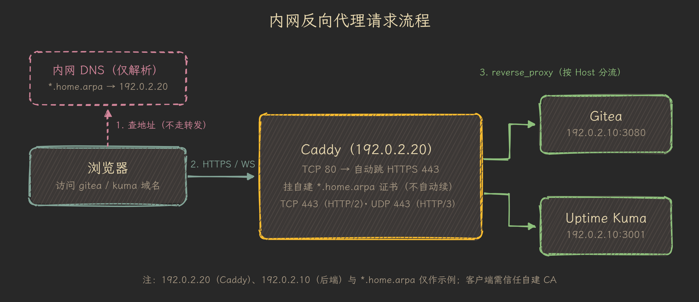

Homelab 环境的服务多了，记端口、维护反代都麻烦。在 NixOS 上的 Caddy 统一域名和 HTTPS，配置放进 Git。

## 为什么选 Caddy

主要是配置少：HTTPS 跳转、WebSocket 和转发头不用逐项补，挂自建证书也方便。家用场景更看重省心。



## 部署步骤

下面统一用 `*.home.arpa`（内网保留域）以及 `192.0.2.10`（后端主机）和 `192.0.2.20`（Caddy 主机）作文档示例，实际替换成自己的域名和内网 IP。

### 1. 把证书放到宿主机

Nix store 全局可读，不要用 `pkgs.writeText` 把私钥写进 Nix 配置；NixOS 的 Caddy 模块默认开启了 `ProtectHome = true`，私钥也别放 `/home` 下。先把自建 CA 签好的通配符证书拷到 `/var/lib/caddy/certs/`（证书 SAN 需覆盖 `*.home.arpa`）：

```bash
sudo install -d -m 0750 /var/lib/caddy/certs
sudo install -m 0644 fullchain.crt /var/lib/caddy/certs/home.arpa.crt
sudo install -m 0600 server.key    /var/lib/caddy/certs/home.arpa.key
```

### 2. 写 NixOS 配置并重建

首次启用 `services.caddy` 时模块才会创建 `caddy` 用户。为了不在首次启动时因私钥属主还是 `root` 而报错，在配置里补上三条 `systemd.tmpfiles.rules`：NixOS 重建激活时先建好用户，再在普通服务启动前执行 tmpfiles 的 `d`/`z` 规则，把目录和证书属主改成 `caddy:caddy` 并保持私钥 `0600`。

NixOS 的 `services.caddy` 会自动生成 `/etc/caddy/caddy_config`。在主机配置里加上：

```nix
services.caddy = {
  enable = true;
  openFirewall = true; # 放行 TCP 80/443，以及 HTTP/3 需要的 UDP 443

  extraConfig = ''
    (home_tls) {
      tls /var/lib/caddy/certs/home.arpa.crt /var/lib/caddy/certs/home.arpa.key
    }
  '';

  virtualHosts."gitea.home.arpa".extraConfig = ''
    import home_tls
    reverse_proxy 192.0.2.10:3080
  '';

  virtualHosts."kuma.home.arpa".extraConfig = ''
    import home_tls
    reverse_proxy 192.0.2.10:3001
  '';
};

systemd.tmpfiles.rules = [
  "d /var/lib/caddy/certs 0750 caddy caddy -"
  "z /var/lib/caddy/certs/home.arpa.crt 0644 caddy caddy -"
  "z /var/lib/caddy/certs/home.arpa.key 0600 caddy caddy -"
];
```

执行重建即可：

```bash
sudo nixos-rebuild switch
```

显式写 `tls cert key` 后，Caddy 不会再替这些域名申请或自动续签证书，但 80 跳 443、WebSocket 和 `X-Forwarded-*` 转发头依然默认生效。

### 3. 切 DNS 前用 --resolve 预演

先别急着改路由器 DNS，在本地用 `curl --resolve` 直接指着这台 Caddy 主机（`192.0.2.20`）把站点测一遍，顺便核对实际连接的 IP 和返回页面：

```bash
# 1. 验证 HTTP 80 自动 308 跳转到 HTTPS
curl -I --resolve gitea.home.arpa:80:192.0.2.20 http://gitea.home.arpa

# 2. 用自建 CA 根证书验证 HTTPS、实际连到的 IP，并检查返回的是目标应用页面
curl -sS -o /dev/null --cacert /path/to/home-ca.crt \
  --resolve gitea.home.arpa:443:192.0.2.20 \
  -w "remote_ip=%{remote_ip} code=%{http_code}\n" \
  https://gitea.home.arpa

curl -sS --cacert /path/to/home-ca.crt \
  --resolve gitea.home.arpa:443:192.0.2.20 \
  https://gitea.home.arpa | head -n 10
```

确认连到了 `192.0.2.20`、跳转和页面内容都符合预期，再切 DNS。

### 4. 切内网 DNS 并验收

把局域网 DNS（如 dnsmasq）里的 `gitea.home.arpa`、`kuma.home.arpa` 指向 Caddy 主机 `192.0.2.20`。路由器、NAS、虚拟化宿主机这类底层管理入口建议保持 DNS 直连，避免反代主机维护时连管理页都打不开。

切完后做两项检查：

1. 核对实际命中的 IP 与页面：

```bash
curl -sS -o /dev/null --cacert /path/to/home-ca.crt \
  -w "remote_ip=%{remote_ip} code=%{http_code}\n" \
  https://gitea.home.arpa
```

确认 `remote_ip` 已是 `192.0.2.20` 且页面能正常打开（`Via` 响应头可能被后续配置删改，不单独作为判断依据）。

2. 验证 WebSocket 与 HTTP/3：浏览器打开 Uptime Kuma，在开发者工具 Network 的 WS 面板看升级请求返回 `101 Switching Protocols` 且持续收到消息帧，才算确认 WebSocket 透传正常。HTTP/3 在放行 UDP 443 后仍依赖客户端支持，浏览器通常会先走 HTTP/2，收到 `Alt-Svc` 后再切换。

## 几个容易踩的坑

- 切完 DNS 浏览器还连旧 IP：按顺序排查本机 `/etc/hosts` 是否残留旧记录、系统或浏览器 DNS 缓存未刷新、浏览器是否开启了 DoH 绕过局域网 DNS，以及已有长连接复用（重开浏览器或新开无痕窗口通常能隔离连接池问题）。
- Gitea 走 SSH 拉代码：Caddy 只反代 HTTP/HTTPS，如果 Git remote 用的是 `ssh://git@gitea.home.arpa:2222/...`，把域名改指 Caddy 主机后 SSH 会不通。可以给 SSH 单独留一个直连域名，或者在客户端 `~/.ssh/config` 为该主机指定实际可直达的目标 `HostName`。
- 部分后端会拒收反代请求：比如 Home Assistant 默认不信任反代，会返回 `400 Bad Request`，需要在 `configuration.yaml` 里加上代理信任：

```yaml
http:
  use_x_forwarded_for: true
  trusted_proxies:
    - 192.0.2.20
```

反过来，Caddy 默认会忽略客户端发来的 `X-Forwarded-*` 以防伪造，只有 Caddy 前面还套了一层代理时才需要在全局选项里配 `servers { trusted_proxies ... }`。

- 客户端信任与换证：外部自建 CA 需要手动装进常用设备的系统或浏览器信任库（`caddy trust` 只管理 Caddy 自带的本地 CA）。证书临期时替换磁盘文件再执行 `sudo systemctl reload caddy`，注意 reload 默认会断开当前挂着的 WebSocket 长连接。

参考：
- [Caddy Automatic HTTPS](https://caddyserver.com/docs/automatic-https)
- [Caddy reverse_proxy](https://caddyserver.com/docs/caddyfile/directives/reverse_proxy)
- [NixOS Wiki: Caddy](https://wiki.nixos.org/wiki/Caddy)
- [systemd-tmpfiles](https://freedesktop.org/software/systemd/man/latest/systemd-tmpfiles.html)
