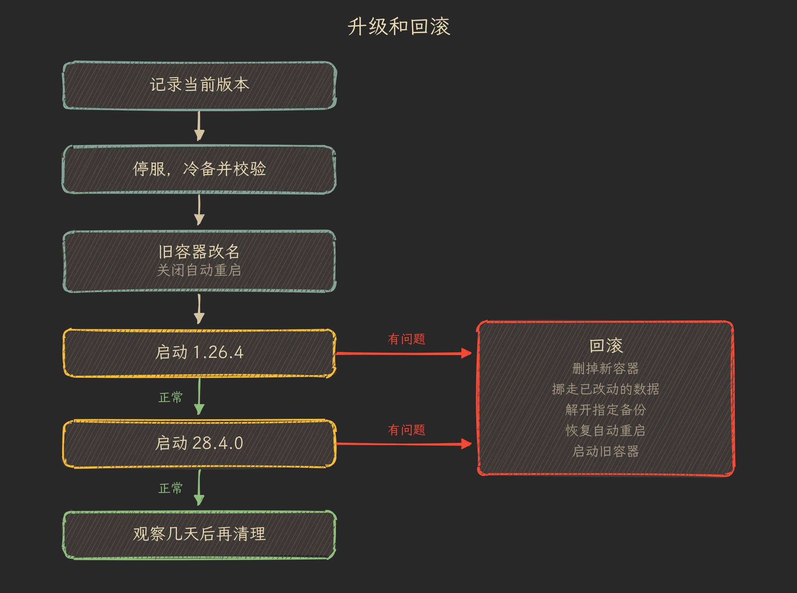

## 一、准备

NAS 上的 Gitea 用 Docker rootless 镜像，数据库是 SQLite，网络模式为 host。这次从 1.23.4 升级，先到 1.26.4，检查正常后再到 28.4.0，镜像都固定版本。



## 二、停服和备份

路径和主机名换成自己的。备份放在数据目录外面，记下完整文件名，回滚只用这一份。

```bash
GITEA_HOME=/opt/gitea          # 下面应有 config/ 和 data/
BACKUP=/opt/gitea-backup-1.23.4-2026-11-24-1900.tar.gz
```

先记当前版本，再停服后备份，免得库和仓库对不上。打包和恢复用 root，才能保住属主和权限（rootless 默认 1000:1000）。

```bash
curl -sf http://<LAN_HOST>:<HTTP_PORT>/api/v1/version

docker stop gitea
docker rename gitea gitea-1.23.4-bak
docker update --restart no gitea-1.23.4-bak

sudo tar -cpzf "$BACKUP" -C "$(dirname "$GITEA_HOME")" "$(basename "$GITEA_HOME")"
sudo tar -tzf "$BACKUP" | grep -E 'config/app.ini$|data/data/gitea.db$'
```

旧容器若仍是 `restart always`，NAS 或 Docker 重启后会和新容器抢端口，改名后立刻关掉。SQLite 默认在 `$GITEA_HOME/data/data/gitea.db`，以 `app.ini` 的 `PATH` 为准，确认备份里有它和 `app.ini`。

## 三、分两步升级

```bash
run_gitea() {
  docker run -d \
    --name gitea \
    --restart always \
    --network host \
    -e TZ=Asia/Shanghai \
    -v "$GITEA_HOME/config":/etc/gitea \
    -v "$GITEA_HOME/data":/var/lib/gitea \
    "gitea/gitea:${1}-rootless"
}

run_gitea 1.26.4
```

等数据库迁移结束、端口起来后再查。版本应是 1.26.x，页面能开，SSH 能列出引用：

```bash
curl -sf http://<LAN_HOST>:<HTTP_PORT>/api/v1/version
docker logs --tail 100 gitea
git ls-remote ssh://<LAN_HOST>:<SSH_PORT>/<owner>/<repo>.git
```

没问题再往上。不要删 `gitea-1.23.4-bak` 和备份包。

```bash
docker stop gitea && docker rm gitea
run_gitea 28.4.0
```

再等迁移结束。版本应是 28.4.0；浏览器看仓库、PR、Issue；`git ls-remote` 和 `git fetch` 能通；容器里跑 `docker exec gitea gitea doctor check`。有 runner 或监控的，看还在不在线。

## 四、回滚

回滚只能回到备份那一刻，之后的提交和改动都不在备份里。

还没启动过 1.26.4 或 28.4.0 的话，数据没被迁移，改回旧容器即可：

```bash
docker rename gitea-1.23.4-bak gitea
docker update --restart always gitea
docker start gitea
```

新版本启动过，就要先挪走已改过的数据，再解开记下的那份备份。不要删旧容器壳和备份包：

```bash
docker stop gitea && docker rm gitea
mv "$GITEA_HOME" "${GITEA_HOME}.failed-$(date +%F-%H%M)"
sudo tar -xzpf "$BACKUP" -C "$(dirname "$GITEA_HOME")"
docker rename gitea-1.23.4-bak gitea
docker update --restart always gitea
docker start gitea
```

## 五、清理

稳定几天后再删旧容器壳、过渡镜像和不再需要的备份。日志若开过 `debug`，可以改回 `info`。

参考：[官方升级说明](https://docs.gitea.com/installation/upgrade-from-gitea/)。
