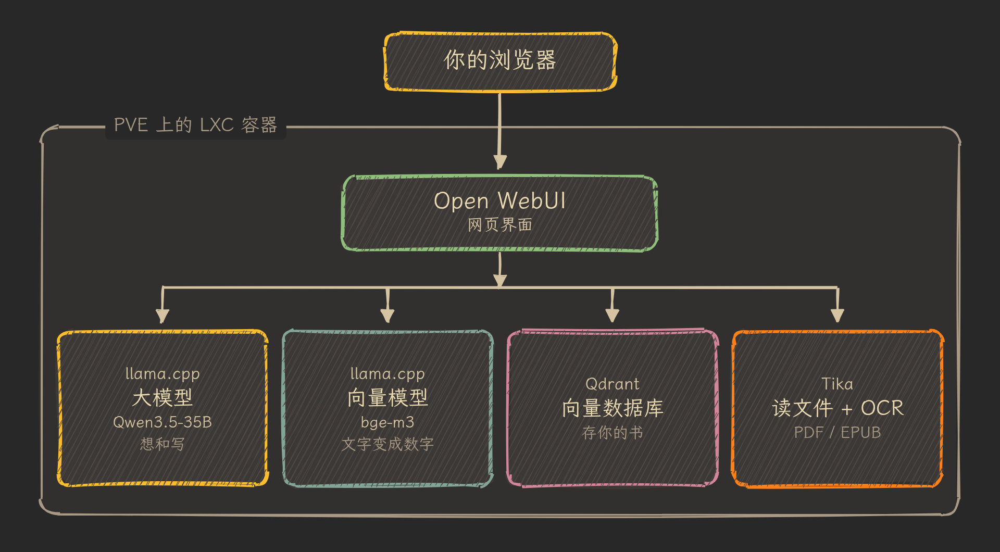

家里一台普通服务器，没有独立显卡，也能跑一个会读书、会翻译、会回答问题的本地 AI。下面是我从零搭建的过程，以及踩过的坑和实测速度。

## 一、我想要什么？

我有不少电子书和 PDF。想要一个 AI，可以：

- 读我的书：把 PDF、EPUB 放进去，以后直接提问
- 用中文回答：外文资料也能用中文提问
- 翻译、总结：外文译成中文，长文章收成几句话
- 完全私有：资料不上传到网上，也不用按月付费

这种「先查资料，再回答」的方式，叫 RAG（检索增强生成）。

## 二、我的硬件

| 部件 | 配置 |
| --- | --- |
| CPU | Intel i7-12700（8 个大核 + 4 个小核） |
| 显卡 | 只有 CPU 自带的核显 UHD 770（没有独立显卡） |
| 内存 | 128GB DDR4（4 × 32GB） |
| 硬盘 | 2 块 1TB NVMe 固态硬盘 |
| 系统 | Proxmox VE（PVE，一个虚拟机管理系统） |

重点：没有独立显卡。所以这篇文章讲的是只用 CPU 跑 AI。

## 三、整体结构



这些服务全部放在 PVE 的一个 LXC 容器里，用 Docker Compose 一起管理。

| 组件 | 作用 | 为什么选它 |
| --- | --- | --- |
| llama.cpp | 运行大模型 | 只用 CPU 也很快，支持 GGUF 格式 |
| Qwen3.5-35B-A3B | 大模型 | 中文好，多语言也不错；每个字只用 3B 参数，CPU 也跑得动 |
| bge-m3 | 向量模型 | 支持很多语言，中文效果好 |
| Qdrant | 向量数据库 | 简单、稳定 |
| Tika | 读文件 + OCR | 支持 PDF、EPUB、Word 等，可以识别中文扫描件 |
| Open WebUI | 网页界面 | 自带知识库功能，像 ChatGPT 一样好用 |

## 四、为什么选 A3B 这种模型？

这是最重要的一点。

普通模型（比如 32B）：每写一个字，要用到全部 32B 参数。CPU 会非常慢。

MoE 模型（比如 35B-A3B）：模型虽然有 35B，但每写一个字只用 3B（A3B = Active 3B）。

CPU 跑 AI 的速度，主要看内存每秒能读多少数据。每个字用到的参数越少，就越快。没有显卡的话，一定选 MoE 模型（名字里有 A3B、A2B 这种）。

## 五、搭建步骤

下面的容器编号写成 `<CTID>`，换成你自己的就行。

### 第 1 步：创建 LXC 容器

在 PVE 主机上：

```bash
# 下载 Debian 12 模板
pveam update
pveam download local debian-12-standard_12.12-1_amd64.tar.zst

# 创建容器：16 线程、72G 内存、200G 硬盘、开机自启
pct create <CTID> local:vztmpl/debian-12-standard_12.12-1_amd64.tar.zst \
  --hostname ai-rag --unprivileged 1 --features nesting=1,keyctl=1 \
  --cores 16 --memory 73728 --swap 4096 \
  --rootfs local-lvm:200 \
  --net0 name=eth0,bridge=vmbr0,ip=dhcp \
  --onboot 1

# 只用大核（12700 的 CPU 0-15 是大核）
echo "lxc.cgroup2.cpuset.cpus: 0-15" >> /etc/pve/lxc/<CTID>.conf
```

内存怎么定？模型文件多大，就至少要多少内存，再多留 10–20G 给其他服务。

### 第 2 步：在容器里安装 Docker

```bash
pct enter <CTID>
apt-get update && apt-get install -y ca-certificates curl
install -m 0755 -d /etc/apt/keyrings
curl -fsSL https://download.docker.com/linux/debian/gpg -o /etc/apt/keyrings/docker.asc
echo "deb [signed-by=/etc/apt/keyrings/docker.asc] https://download.docker.com/linux/debian bookworm stable" \
  > /etc/apt/sources.list.d/docker.list
apt-get update && apt-get install -y docker-ce docker-ce-cli containerd.io docker-compose-plugin
```

**坑 1：Docker 在 LXC 里跑不起来**

报错：`open sysctl net.ipv4.ip_unprivileged_port_start file: permission denied`

原因：新版 Docker 和旧版 PVE（8.1）的 LXC 不兼容。

解决：在 PVE 主机的 `/etc/pve/lxc/<CTID>.conf` 里加两行，然后重启容器：

```
lxc.apparmor.profile: unconfined
lxc.mount.entry: /dev/null sys/module/apparmor/parameters/enabled none bind 0 0
```

这样会降低这个容器的隔离性。升级到新版 PVE 以后，可以把这两行删掉。

### 第 3 步：下载模型

```bash
mkdir -p /opt/ai-rag/models && cd /opt/ai-rag/models

# 大模型（22GB）—— 国内推荐用魔搭社区，快很多
wget -c https://modelscope.cn/models/unsloth/Qwen3.5-35B-A3B-GGUF/resolve/master/Qwen3.5-35B-A3B-Q4_K_M.gguf

# 向量模型（0.6GB）
wget -c https://hf-mirror.com/gpustack/bge-m3-GGUF/resolve/main/bge-m3-Q8_0.gguf
```

下载小技巧：

- 先看魔搭社区（ModelScope）有没有。我测试过，比 hf-mirror 快 20 倍。
- 用 `wget -c`，断了可以接着下载。
- 下载完核对一下 sha256，确认文件完整。

### 第 4 步：让 Tika 支持中文 OCR

Tika 官方镜像的 OCR 没有中文语言包，自己加一下。

`/opt/ai-rag/tika/Dockerfile`：

```dockerfile
FROM apache/tika:3.2.3.0-full
USER root
RUN apt-get update && apt-get install -y --no-install-recommends \
      tesseract-ocr-chi-sim tesseract-ocr-chi-tra \
    && rm -rf /var/lib/apt/lists/*
USER 35002:35002
```

`/opt/ai-rag/tika/tika-config.xml`：

```xml
<?xml version="1.0" encoding="UTF-8"?>
<properties>
  <parsers>
    <parser class="org.apache.tika.parser.DefaultParser">
      <parser-exclude class="org.apache.tika.parser.ocr.TesseractOCRParser"/>
    </parser>
    <parser class="org.apache.tika.parser.ocr.TesseractOCRParser">
      <params>
        <param name="language" type="string">chi_sim+eng</param>
        <param name="preserveInterwordSpacing" type="bool">true</param>
      </params>
    </parser>
  </parsers>
</properties>
```

**坑 2：Tika 默认只认英文**

不改配置的话，中文扫描件识别出来是乱码。一定要设置 `language`。

**坑 3：不要用 Tika 4.x**

Tika 4.2 改了配置格式，文档很少，很难配。Open WebUI 也是按 Tika 3 设计的。用 3.2 版本最省事。

### 第 5 步：Docker Compose

`/opt/ai-rag/.env`：

```bash
LLM_MODEL=Qwen3.5-35B-A3B-Q4_K_M.gguf
LLM_ALIAS=qwen3.5-35b
LLM_CTX=32768
LLM_THREADS=8
LLM_THREADS_BATCH=16
```

`/opt/ai-rag/docker-compose.yml`：

```yaml
name: ai-rag

services:
  # 大模型（只用 CPU）
  llm:
    image: ghcr.io/ggml-org/llama.cpp:server-b12407
    container_name: llm
    restart: unless-stopped
    volumes:
      - ./models:/models:ro
    ports:
      - "8080:8080"
    command: >
      -m /models/${LLM_MODEL}
      --alias ${LLM_ALIAS}
      --host 0.0.0.0 --port 8080
      -c ${LLM_CTX} -np 1
      -t ${LLM_THREADS} -tb ${LLM_THREADS_BATCH}
      --reasoning-budget 0
      --jinja --flash-attn on
      --cache-type-k q8_0 --cache-type-v q8_0
      --temp 0.6 --top-p 0.95 --top-k 20 --min-p 0

  # 向量模型
  embed:
    image: ghcr.io/ggml-org/llama.cpp:server-b12407
    container_name: embed
    restart: unless-stopped
    volumes:
      - ./models:/models:ro
    command: >
      -m /models/bge-m3-Q8_0.gguf --alias bge-m3
      --host 0.0.0.0 --port 8081
      --embedding --pooling cls
      -c 8192 -b 8192 -ub 8192 -np 2 -t 4
    healthcheck:
      test: ["CMD", "curl", "-fs", "http://localhost:8081/health"]
      interval: 30s

  qdrant:
    image: qdrant/qdrant:v1.20.1
    container_name: qdrant
    restart: unless-stopped
    volumes:
      - ./data/qdrant:/qdrant/storage

  tika:
    build: ./tika
    image: local/tika-zh:latest
    container_name: tika
    restart: unless-stopped
    command: ["-c", "/config/tika-config.xml"]
    volumes:
      - ./tika/tika-config.xml:/config/tika-config.xml:ro

  open-webui:
    image: ghcr.io/open-webui/open-webui:v0.13.3
    container_name: open-webui
    restart: unless-stopped
    depends_on: [llm, embed, qdrant, tika]
    ports:
      - "3000:8080"
    volumes:
      - ./data/open-webui:/app/backend/data
    environment:
      - ENABLE_OLLAMA_API=false
      - OPENAI_API_BASE_URLS=http://llm:8080/v1
      - OPENAI_API_KEYS=none
      - VECTOR_DB=qdrant
      - QDRANT_URI=http://qdrant:6333
      - CONTENT_EXTRACTION_ENGINE=tika
      - TIKA_SERVER_URL=http://tika:9998
      - RAG_EMBEDDING_ENGINE=openai
      - RAG_OPENAI_API_BASE_URL=http://embed:8081/v1
      - RAG_OPENAI_API_KEY=none
      - RAG_EMBEDDING_MODEL=bge-m3
      - ENABLE_RAG_HYBRID_SEARCH=true
      - RAG_RERANKING_MODEL=BAAI/bge-reranker-v2-m3
      - RAG_TOP_K=10
      - RAG_TOP_K_RERANKER=5
      - CHUNK_SIZE=1000
      - CHUNK_OVERLAP=150
      - HF_ENDPOINT=https://hf-mirror.com
```

镜像都钉了具体版本（这是 2026-11-15 写这篇文章时的版本），以后重建不会被自动更新改掉。

启动：

```bash
cd /opt/ai-rag
docker compose up -d --build
docker compose ps
```

浏览器打开 `http://<容器IP>:3000`。第一个注册的账号就是管理员，记得马上注册。3000 和 8080 这两个端口都没有访问控制，只在家里的局域网用，不要直接暴露到公网。

### 第 6 步：Open WebUI 里一定要改的设置

**坑 4：问一句话，AI 半天没反应**

新版 Open WebUI 会在每个问题后面，偷偷加上很多「内置工具」的说明（记忆、笔记、日历、代码解释器……），大约 3000–6000 个 token。你只问了 4 个字，AI 却要先读几千个 token。CPU 读这些要 1–2 分钟，看起来就像没反应。

解决（管理员面板 → 设置）：

- 关掉用不到的功能：记忆、笔记、日历、自动化、代码解释器、网页搜索。
- 关掉后台任务：追问建议、自动标签、搜索查询生成。
- 模型设置里，把 Function Calling 改成 `Legacy`（这一步最重要）。

## 六、我踩过的其他坑

**坑 5：用核显加速，结果输出乱码**

我一开始用 llama.cpp 的 Vulkan 版本，让核显 UHD 770 帮忙算。

结果：输入一长段（几千字），AI 就开始输出乱码（「迎迎迎迎迎……」），而且以后一直坏着，要重启才好。

原因：Intel 核显 + Flash Attention 有 bug。

最后的结论更有意思：核显比 CPU 还慢。

| 方式 | 写字速度 | 读字速度 |
| --- | --- | --- |
| 核显（Vulkan 版） | 8.6 个/秒 | 51 个/秒 |
| 只用 CPU（普通版） | 11.3 个/秒 | 58 个/秒 |

没有独立显卡，就直接用 CPU 版，不要折腾核显。

**坑 6：内存不够，AI 越来越慢**

Vulkan 版会把模型在内存里放两份（一份文件缓存，一份核显用）。容器内存满了以后，系统一直从硬盘重新读，速度很慢。

容器内存一定要比模型大很多。用 CPU 版的话，模型只放一份。

**坑 7：内存条没开 XMP**

我的内存条是 3200 的，但是 BIOS 默认只跑 2133。进 BIOS 打开 XMP（我的是华硕主板：Ai Tweaker → Ai Overclock Tuner → XMP I）。

CPU 跑 AI 主要靠内存速度，开了以后快了大约 30%。

**坑 8：建容器的时候，硬盘卡死了**

格式化 200G 硬盘的时候，三星 980（老固件）一直超时，整个系统都卡住了，最后只能硬重启。

如果你用三星 980：

- 在 GRUB 里加：`nvme_core.default_ps_max_latency_us=0 pcie_aspm=off`
- 把固件升级到最新版本。

## 七、三个模型的真实对比

同一台机器，只用 CPU，内存 3200：

| 模型 | 写字速度 | 读同一段资料 | 文件大小 |
| --- | --- | --- | --- |
| Qwen3.5-35B-A3B | 12.3 字/秒 | 22 秒 ⭐ | 22G |
| Qwen3-30B-A3B-Instruct-2507 | 15.2 字/秒 ⭐ | 58 秒 | 18.6G |
| Qwen3-Next-80B-A3B | 10.0 字/秒 | 39 秒 | 48.5G |

三个模型的翻译和总结质量差不多。知识库每次都要先读很多资料，所以读得快最重要。我最后选了 Qwen3.5-35B-A3B。

## 八、怎么用？

**建知识库**

1. 工作空间 → 知识库 → +，起个名字。
2. 把 PDF、EPUB 拖进去（可以一次拖很多个，也可以上传整个文件夹）。
3. 等它处理完。

**提问**

1. 新建对话。
2. 输入 `#`，选你的知识库。
3. 用中文问问题。回答下面会显示用了哪些资料。

**总结一个 PDF**

1. 对话里点 + 上传 PDF。
2. 点文件，打开「使用完整文档」。
3. 输入：`请用中文总结这个文件`。

**给其他程序用**

模型地址是 OpenAI 格式，很多工具都可以直接用：

```
http://<容器IP>:8080/v1
```

比如 pi agent（终端里的 AI 助手），配置 `~/.pi/agent/models.json`：

```json
{
  "providers": {
    "homelab": {
      "baseUrl": "http://<容器IP>:8080/v1",
      "api": "openai-completions",
      "apiKey": "none",
      "models": [
        { "id": "qwen3.5-35b", "contextWindow": 32768, "maxTokens": 8192 }
      ]
    }
  }
}
```

## 九、只用 CPU，到底能干什么？

| 很适合 | 一般 | 做不了 |
| --- | --- | --- |
| 查自己的资料（知识库） | 大型编程项目 | 最新新闻（不能上网） |
| 翻译、总结 | 很难的数学题 | 一次读完一整本书 |
| 学语言（当老师） | 写邮件、改文章 | |

速度大概是：问一个知识库问题，等 20–40 秒开始回答，然后每秒写 10 个字左右。

## 十、要不要买显卡？

|  | 只用 CPU | 加一张 16G 显卡 |
| --- | --- | --- |
| 写字 | 约 12 字/秒 | 约 30–50 字/秒 |
| 知识库提问要等多久 | 20–40 秒 | 几秒 |
| 能做的事 | 一样 | 一样 |

显卡主要是让 AI 变快，不是让 AI 变聪明。

我的建议：先用 CPU 版用几个星期。如果天天用、常常觉得慢，再买显卡（二手 RTX 3090 24G 性价比很高）。

## 十一、总结

- 没有显卡也可以跑本地 AI，关键是选 MoE 模型（A3B）。
- 内存速度很重要，记得开 XMP。
- 核显帮不上忙，直接用 CPU 版 llama.cpp。
- Open WebUI 要关掉内置工具，否则会非常慢。
- 下载模型先找魔搭社区，国内快很多。
