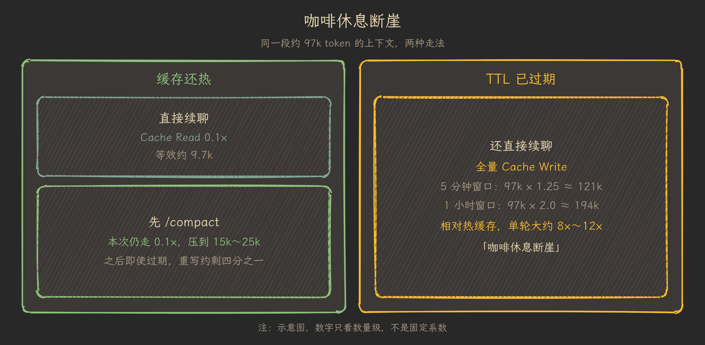
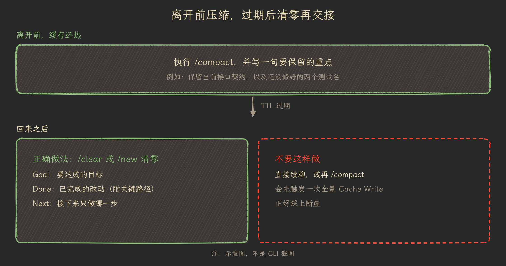

用 Claude Code 这类 CLI 写代码，会话一长，额度经常不是被输出吃掉，而是耗在 Prompt Cache 上。前缀缓存有 TTL：前段文本没变、还在窗口里，续聊往往只需付一折，部分新模型低到只要原来的百分之五；一旦过期，或者中途改了前缀，同一段上下文就要按高价做一次冷重写。

网上那几条省流办法，机制是成立的。不过常被引用的倍数（9.83 倍、2.5 倍、28%、15%～64%、1.8 倍）来自小样本实测，只看数量级，不要当成固定系数。下面以 Claude Code 为主，顺便对照 Antigravity（`agy`）、Kimi Code 和 OpenCode。

## Claude Code 怎么计费

默认缓存窗口并不统一。用 API Key、Bedrock、按量超额额度，或者 Subagent，默认是 5 分钟；Pro / Max 订阅额度内的主会话，默认是 1 小时。命中缓存会自动续期。

从 Claude Code v2.1.242 起，可以在 `~/.claude/settings.json` 或项目里的 `.claude/settings.json` 里显式写 `"promptCacheTtl": "1h"`、`"subagentPromptCacheTtl": "1h"`，也可以用环境变量 `CLAUDE_CODE_PROMPT_CACHE_TTL`。

读写价格也不一样。5 分钟缓存的写入是基础输入价的 1.25 倍，1 小时写入是 2.0 倍；读取一般是 0.1 倍（相当于一折，部分新模型更低）。按这个算法，5 分钟缓存大约第 2 轮回本，1 小时缓存大约第 3 轮回本。

社区把这种情况叫「咖啡休息断崖」（Coffee-Break Cliff）。缓存还热的时候，续聊一段约 9.7 万 token 的上下文，只付 `97k × 0.1 ≈ 9.7k` 的等效输入；一旦过期再续，就要做全量 Cache Write：5 分钟窗口是 `97k × 1.25 ≈ 121k`，1 小时窗口是约 `194k`。跟热缓存、或者一个只有 1 万到 1.5 万 token 的新会话比，单轮很容易到 8 倍到 12 倍。9.83 倍这种精确数字只是小样本，数量级是对的。



热缓存续聊只付缓存读价；TTL 过期后再直接续聊，会按全量 Cache Write 计费。图中数字只说明数量级，不是固定系数。

## 常用做法

离开前，趁缓存还热，先执行一次 `/compact`。这次压缩走的是 0.1 倍的缓存读价，可以把大约 9.7 万 token 压到 1.5 万到 2.5 万。回来即使已经过期，重写成本大约只剩原来的四分之一。有一组小样本测到大约 2.5 倍，数量级对得上，但不要当成固定系数。这比干等自动压缩更稳妥：自动压缩往往在模型已经进入「变笨区间」时才触发。

缓存一旦过期，就不要直接续聊，也不要再 `/compact`。过期后再压缩，会先触发一次全量 Cache Write，正好踩在断崖上。更干脆的做法是 `/clear` 清零，用 Goal / Done / Next 三句话，带上关键文件路径，重新冷启动。成本最低，上下文也最干净。



离开时缓存还热，先压缩并写下要保留的重点；回来若已过 TTL，直接清零，再用 Goal、Done、Next 三句话接着做。

相关的小任务可以放在同一会话里。TTL 内复用热缓存，能少付几次冷启动写入——不用反复重读 `CLAUDE.md` 和项目文件，有人测到大约能省两到三成，同样只作参考。但无关任务不要硬塞。上下文一旦超过大约 30% 到 40%，模型会进入「变笨区间」，返工的成本比省下来的缓存高得多。

工具输出也要截短。几千行日志一旦进了对话历史，不但本轮要付钱，后面每一轮都会带着它；过期重写时一起买单，注意力也被稀释。日志先用 `tail -50`、`head` 或 `grep` 过滤再给模型。

有人说尽量用 CLI，Desktop Code Tab 更费，这件事要谨慎看待。社区和 GitHub issue 里有过实测：`sdk-cli`、headless、Desktop Code Tab 相对交互式 TUI CLI，额度大约是 1.8 倍到 2.4 倍，可能来自 UI 状态同步、wrapper system prompt、工具定义差异，或远程控制通道的开销。样本小，而且随版本变化快。省额度时可以优先用 CLI，但不必把它当成定律。

另外，长会话中途切模型、增删 MCP 工具定义，会立刻击穿缓存。`rewind` 通常比在原会话里来回纠正更划算；稳定的规则可以放进 `.claude/rules/`，按路径懒加载。

## 四家 CLI 对照

Claude Code、Antigravity（`agy`）、Kimi Code、OpenCode 都依赖严格前缀匹配。续聊要便宜，就得让前缀保持不变，并且还在 TTL 里。

|  | Claude Code | Antigravity（agy） | Kimi Code | OpenCode |
|---|---|---|---|---|
| 缓存机制 | Anthropic 显式断点缓存，自动托管 | Gemini 隐式上下文缓存，默认开启 | Moonshot 自动前缀缓存（`mode: "implicit"`） | 跟随所接 Provider；会在系统提示和近期对话边界注入 `cache_control` |
| 默认 TTL | API Key 等 5 分钟；Pro / Max 额度内主会话 1 小时，可配置 | 由 Gemini 后端托管；Gemini 4+ 可配置 TTL | 默认 5 分钟；API 支持 `prompt_cache_options.ttl: "1h"` | 跟随 Provider（接 Anthropic 就是 5 分钟 / 1 小时） |
| 读 / 写倍率 | 读 0.1×；写 5 分钟 1.25×、1 小时 2.0× | Gemini 2.5 / 3 读 0.1×，Gemini 4+ 读 0.05×；需达到 2k / 4k 的最小前缀 | 读 0.1×（如 K3 / K3.1 Pro）；写 5 分钟 1.0×、1 小时 2.0× | 跟随 Provider |
| 压缩 / 清零 | `/compact`、`/clear` | `/compact`、`/clear`（别名 `/new`） | `/compact`；`/clear` 或 `/new` | `/compact`（别名 `/summarize`，`ctrl+x c`）；`/new`（别名 `/clear`，`ctrl+x n`） |

观察占用的方式不一样：Claude Code 用 `/context` 和 `/cost`；agy 的 `/context` 能看到 Rules、Skills、Artifacts 和压缩阈值；Kimi 可以看会话日志 `~/.kimi-code/sessions/`，或 API 里的 `usage.prompt_tokens_details`；OpenCode 用内置 stats，或到 Provider 后台看 Cache Read 占比。

## Antigravity、Kimi Code 和 OpenCode

Antigravity（`agy` CLI / IDE / 2.0）适合把旁路问题交给 `/btw`。临时查个概念、问一句无关的话，用 `/btw <问题>` 不会写进主对话历史，也就不会撑破上下文、破坏主会话前缀。

压缩不要等后台自动做，自动压缩容易在改代码做到一半时把约束截断。完成一轮调研或一个子功能后，带一句说明，手动 `/compact`。用 `/context` 盯着已加载的 Rules（`.agents/rules/`、`GEMINI.md`）、Skills 和 Artifacts，接近阈值就先处理。稳定规范放进 `.agents/rules/`，并从目标仓库根目录启动 `agy`，避免跨项目串上下文。

Kimi Code 的自动前缀缓存要求开头完全一致，不支持在中间插显式断点，单会话过长还会把输入开销线性拉高。按任务用 `/sessions` 或 `/resume` 切换，换任务就 `/new` 或 `/clear`，不要一条会话聊到底。

`AGENTS.md`、项目结构和固定规范放在最前，大段命令输出截断后再交给模型。离开前 `/compact`、超时后 `/clear` 再三句话交接，这里同样适用。默认 5 分钟缓存过期后再续聊大上下文，会按 1.0 倍全量重算输入；如果开了 1 小时 TTL，写入则是 2.0 倍。5 分钟写入没有溢价，但改了前缀顺序会立刻失效。

OpenCode 可以在 `opencode.json` 里把自动压缩阈值提前设好，以免等到 100% 满载、已经进入「变笨区间」才压缩：

```json
{
  "compaction": {
    "threshold": 0.40,
    "strategy": "summarize",
    "preserveRecentMessages": 10,
    "preserveSystemPrompt": true
  }
}
```

要小心激进的裁剪插件。Dynamic Context Pruning（DCP）这类插件如果改写或删除旧的工具输出，会让 Anthropic、OpenAI 这类严格前缀缓存立刻失配。短会话不建议开激进改写；超长会话再权衡是省总 token，还是冒一次 Cache Miss。

自定义 API 网关也要确保 system / developer message 的格式没被改写，否则每一轮都在付全价。系统提示顶部不要放动态时间戳或路径。

## 通用做法

离开前，缓存还热的时候，手动 `/compact`，并写一句要保留的重点，比如「保留当前接口契约，以及还没修好的两个测试名」。

回来时如果已经过了 TTL，直接 `/clear`（或 `/new`），再用三句话交接：

```text
- Goal：当前要达成的目标
- Done：已完成的文件和改动（附上关键路径）
- Next：接下来只做哪一步
```

相关的小改动，可以在 TTL 内、上下文还低于大约 30% 到 40% 时放在同一会话里做。一旦换了主题，或接近这条线，就果断清掉。别为了省缓存，让回答质量掉下去。

长日志先过滤再进上下文。会话中途不要频繁切模型、开关 MCP，也不要往系统提示头部插动态时间戳。前缀一动，折扣就没了。
